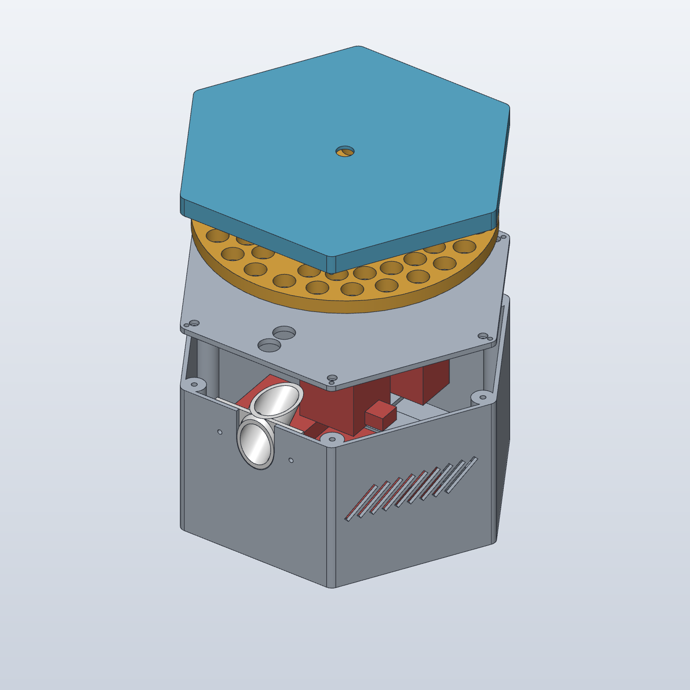
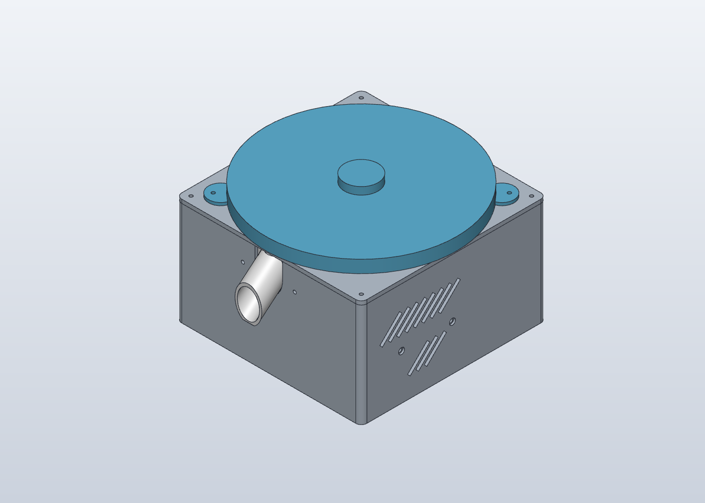
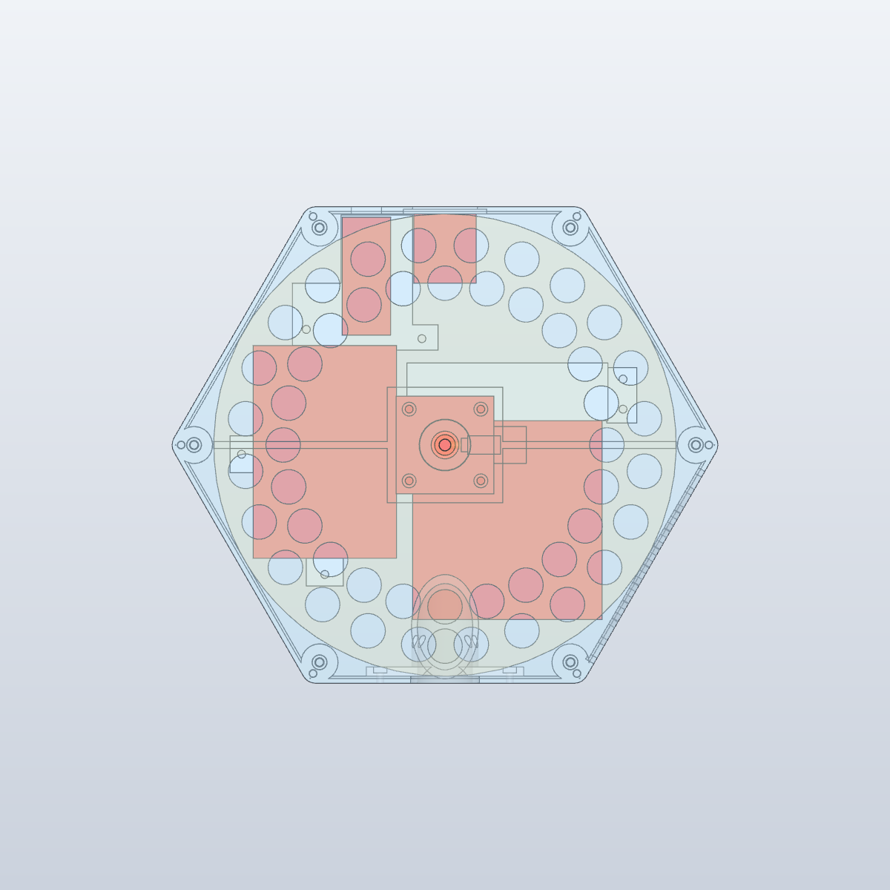
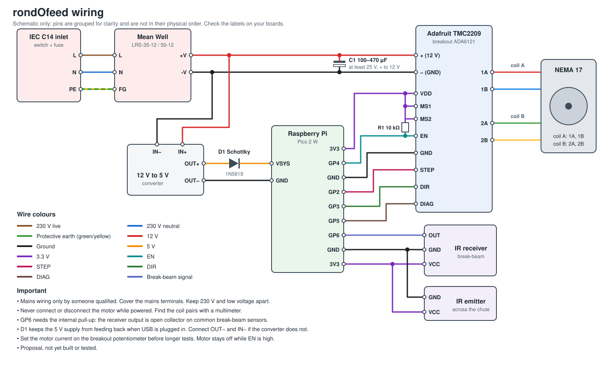
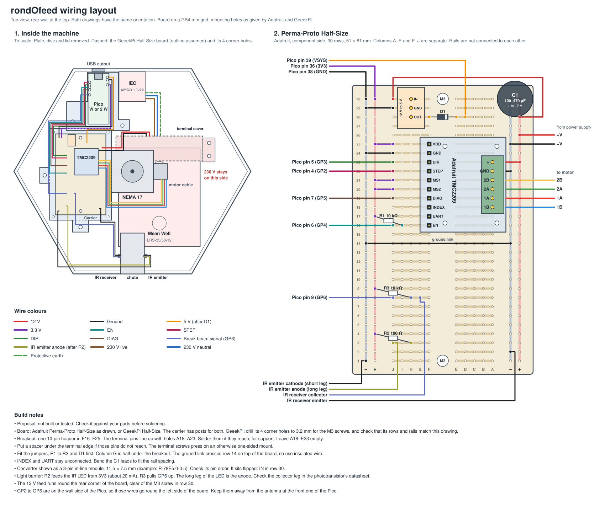

# rondOfeed

**An open, 3D-printable automatic feeder for dogs, birds and other pets.**

<p align="center">
  
</p>

A perforated disc turns on a NEMA 17 stepper motor and releases one portion at a time, which slides down a chute into a bowl. A Raspberry Pi Pico W or Pico 2 W controls it and takes commands over USB serial and Bluetooth (BLE). The housing is a hexagon, like a honeycomb cell.

<table>
  <tr>
    <td></td>
    <td></td>
  </tr>
  <tr>
    <td align="center">Assembled</td>
    <td align="center">Inside: motor, power supply and electronics (red placeholders)</td>
  </tr>
</table>

- **47 portions** on a Ø200 mm disc, each one released separately
- **Fits a Prusa MK4:** every part prints in one piece, hexagonal housing 206 mm across the flats, 236 mm across the corners, 116 mm high
- **Fully parametric:** all dimensions are in one Python script, so you can resize the holes to your pet's food
- **Open:** CERN-OHL-P hardware, Apache 2.0 or MIT software

## Status: version 0.7, help wanted

The rondOfeed is an early design. It has been modelled and checked for collisions, but **it has not been printed or built yet**, and the firmware does not exist yet. That makes this a good time to join in:

- **Build it:** print the parts and report what fits and what does not
- **Finish the firmware:** it takes commands over USB serial and BLE, but the motor and the light barrier have not run yet. [PLAN.md](PLAN.md) has the list of what is left
- **Design new discs:** for small food such as bird seed, which needs a different hole layout
- **Test food types:** tell us what dispenses reliably for your pet

Open an issue with your ideas, questions or build photos. Pull requests are welcome.

The electronics include 230 V mains wiring. Read the [Safety](#safety) section before building.

## Design files

Design: `rondofeed.sc`, made with [SolidCraft](https://docs.solidcraft.io/). Source: `build.py` (dimensions at the top of the file).

To regenerate:

```sh
python3 build.py && solidcraft-cli run rondofeed.json --save rondofeed.sc
```

The `DUMMY_*` bodies in SolidCraft are placeholders only (red) and are not printed.

`step/rondofeed.step` is the same design as solid bodies for other CAD programs such as Autodesk Fusion. It has no parameters, so change dimensions in `build.py` and export again (`file.export` with format `step`). The STEP file contains the standard disc and the short chute only.

## Printing (Prusa MK4, PETG, 0.4 mm nozzle)

The STLs are in assembly orientation. Use "Place on face" in the slicer to orient them like this:

| File | Size (mm) | Face on the bed |
|---|---|---|
| `Base.stl` | 236 × 206 × 112 | Bottom, flat walls front and back |
| `Plate.stl` | 236 × 206 × 10 | Top (flip) |
| `Disc.stl` | Ø200 × 10 | Bottom |
| `Disc_12.stl` (optional) | Ø200 × 10 | Bottom |
| `Disc_10.stl` (optional) | Ø200 × 10 | Bottom |
| `Lid.stl` | 236 × 206 × 16 | Top (flip), the pins point up |
| `Chute.stl` | 68 × 47 × 39 | Flat top, with the screw plate standing on it |
| `Chute_long.stl` (optional) | 68 × 66 × 55 | Same as `Chute.stl` |
| `TerminalCover.stl` | 99.5 × 26 × 40 | Back |
| `Carrier.stl` | 90 × 160.5 × 7 | Bottom |

`Chute.stl` ends flush with the outer wall of the housing, so nothing sticks out. The portions leave the housing about 70 mm above the table, so the bowl can be up to about 70 mm high, but it has to stand right against the wall. `Chute_long.stl` is a longer version that sticks out 19 mm and puts the outlet lower, so a bowl of up to about 57 mm fits under it and it does not have to touch the wall. It fits the same opening and the same screws, and the light barrier holes are in the same place. Use one of the two, not both.

The housing, plate and lid use 206 of the 210 mm bed depth, so turn the skirt off. The lid has the same hexagon as the housing and sits flush on it. It is held by magnets, so there are no screws on top, and 6 small pins on the underside fit into holes in the plate so the lid cannot slide.

## Parts

| Part | Qty | Notes |
|---|---|---|
| NEMA 17 motor, 0.9° (400 steps/turn), 5 mm D-shaft, up to 48 mm long | 1 | Shaft about 24 mm, about 1 A is enough |
| Raspberry Pi Pico W or Pico 2 W | 1 | Same size and pins, both work with the firmware. Bluetooth is used, Wi-Fi is not used yet |
| Mean Well LRS-35-12 or LRS-50-12 | 1 | Same case (Case 239A) |
| Adafruit TMC2209 Breakout (ADA6121) | 1 | No heatsink included, add one if needed |
| Electrolytic capacitor, 100–470 µF, at least 25 V | 1 | Directly on the breakout's 12 V terminals |
| 10 kΩ resistor | 2 | Pull-ups from `EN` and from GP6 (light barrier) to 3V3 |
| Schottky diode 1N5819 | 1 | Between the converter and `VSYS`, see Wiring |
| 12 V to 5 V converter | 1 | On the prototyping board, supplies `VSYS` on the Pico |
| Prototyping board, half size: Adafruit Perma-Proto Half-Size (81 × 51 mm, ADA1609) or GeeekPi Half-Size | 1 | For the breakout, converter and light barrier resistors. Lies lengthwise on the carrier, which has posts for both. Adafruit: 2 holes, 73.7 mm apart. GeeekPi: 4 corner holes, 55 × 85 mm apart, drill them to 3.2 mm. M3×6 self-tapping screws into the posts |
| IR LED, 5 mm, 940 nm, e.g. Vishay TSAL6200 | 1 | Light barrier emitter, in one of the two Ø5.2 mm holes in the chute |
| IR phototransistor, 5 mm, with daylight filter (black), e.g. Osram SFH 300 FA or Everlight PT334-6C | 1 | Light barrier receiver, in the opposite hole |
| 100 Ω resistor | 1 | Series resistor for the IR LED at 3V3, about 20 mA |
| IEC C14 inlet, 3-in-1 module with 2-pole rocker switch and 5 × 20 mm fuse drawer, snap-in, for 230 V | 1 | 28 × 47 mm cutout (width × height). The rear wall is thinned to 2 mm around the cutout for the snap-in clips |
| Fuse 5 × 20 mm, T1A (slow-blow), 250 V | 1 | Replace the 10 A fuse that often comes with the inlet. A spare fits in the drawer |
| M3 threaded inserts, Ø4.0 mm hole | 12 | |
| M3 screws, steel (not stainless, magnets must hold on the heads): M3×8 (power supply, plate), M3×12 (motor and the rest) | 20 | |
| Neodymium disc magnets Ø6 × 2 mm | 6 | Glued into the lid, one over each plate screw |
| M3 nuts for the chute | 2 | |
| M3 set screw and nut | 1 | Locks the disc on the D-flat |
| Rubber feet | 4 | The floor vents need airflow |

## Firmware

MicroPython for the Pico W or Pico 2 W, in [firmware/](firmware/README.md). Commands over USB serial and BLE. Tested on a Pico W without motor and light barrier.

## Wiring



This is a proposal and has not been built or tested yet. Pins are grouped for clarity, so check the labels on your boards. See [PLAN.md](PLAN.md) for the rules for a reliable build.

### Layout in the machine



This shows where each part sits on the Perma-Proto board and how the wires run in the housing. It is also a proposal and has not been built yet. The board lies lengthwise on the left of the motor, and the Pico sits behind it at the rear wall, see the picture above. The board drawing shows the Adafruit Perma-Proto Half-Size. The GeeekPi Half-Size fits the same carrier, check that its rows and rails match before soldering. The schematic only shows the board and the wiring, not the exact position in the housing.

## Discs

All discs fit the same housing, motor and outlets. Smaller holes leave room for more portions. Pick the disc that matches your food.

| File | Hole | Portions | Step per position | Microsteps per position (0.9° motor, 1/16) |
|---|---|---|---|---|
| `Disc.stl` | Ø15 mm | 47 | 7.5° | 133.33 |
| `Disc_12.stl` | Ø12 mm | 59 | 6° | 106.67 |
| `Disc_10.stl` | Ø10 mm | 69 | 5.14° | 91.43 |

The outlets in the plate stay Ø15 mm, so a neighbouring hole can open by up to about 6 mm. Pieces should be larger than that but smaller than the hole, so about 7–9 mm for the 10 mm disc. Smaller food such as seed needs a different design. Add your own disc in `EXTRA_DISCS` at the top of `build.py`.

## Measure on the real part before printing

These values do not come from the purchased parts. If yours differ, change them at the top of `build.py`:

- `IEC_CUT`: the cutout depends on the IEC inlet model
- `IEC_WALL`: wall thickness around the IEC cutout, match it to the panel range of the snap-in clips
- `IR_D`: diameter of the break-beam sensor
- `INSERT_D`: manufacturer's hole size for the threaded insert
- `HOLE_D`: match this to the food, see [Discs](#discs)

Print a test piece before the full print: the disc centre (shaft and set screw) and the motor block.

## Assembly

1. Press in the threaded inserts.
2. Screw the motor to the plate from below, with the screw heads recessed from above.
3. Lay the power supply flat on its two pads, terminals towards the rear: M3×8 from below through the floor, heads recessed. Screws must not reach more than 3 mm into the power supply.
4. Screw the Pico and prototyping board to the carrier (one angled plate, one part under each board), then screw the carrier to the floor. All 4 screws sit clear of the boards. The Pico's USB port faces the cutout in the rear wall. Fit the terminal cover with 2 screws on its right side.
5. Before fitting the plate, push the chute through the front wall from inside. 2 × M3 from outside, nuts inside. The plate has to come off for cleaning.
6. Set the plate on the housing and fix it with 6 M3×8 screws, one in each corner. The heads sit in the counterbores. Set the disc on the shaft with a 0.5 mm gap, and tighten the set screw on the D-flat.
7. Glue one magnet into each of the 6 pockets on the underside of the lid. Polarity does not matter, as the magnets attract the steel screw heads either way. Place the lid on top, with its 6 pins in the holes of the plate. Each magnet sits over a plate screw and holds the lid.

## Safety

Heat: only the power supply has ventilation: slots in the floor below it and in the right front wall above it. Disable the motor driver when idle and check the internal temperature in continuous use. PETG softens at about 70 °C.

230 V: connect protective earth to terminal FG, keep the mains terminals under the cover, route mains and low-voltage wiring separately, and use strain relief. Mains wiring must only be done by someone qualified to do it safely.

The disc, lid and chute touch food: use food-safe filament, and clean or replace these parts regularly.

## Control

Position 0 is closed, and each further position releases one portion. The step size depends on the disc, see [Discs](#discs). Accumulate the target position and round that, rather than rounding each step.

## License

Hardware (`rondofeed.sc`, `rondofeed.json`, `stl/`, `images/`) is licensed under the [CERN Open Hardware Licence Version 2 - Permissive](LICENSE-HARDWARE).

All software, including `build.py`, is licensed under either of [Apache License, Version 2.0](LICENSE-APACHE) or [MIT license](LICENSE-MIT) at your option.
